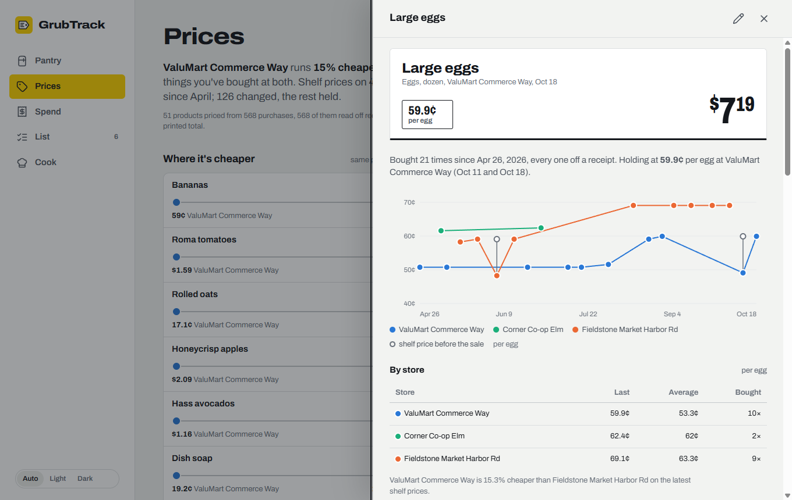
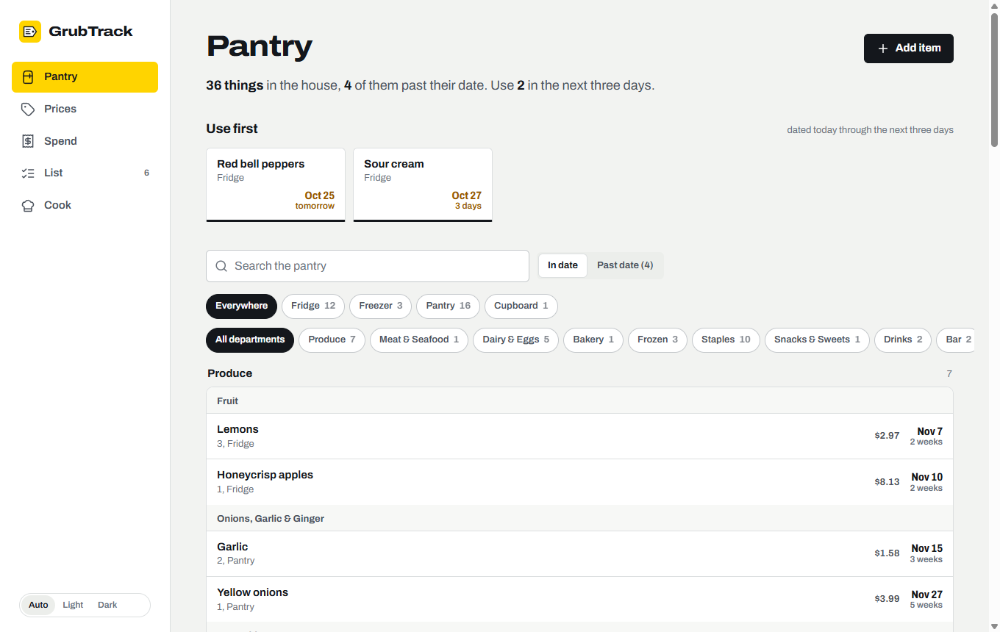
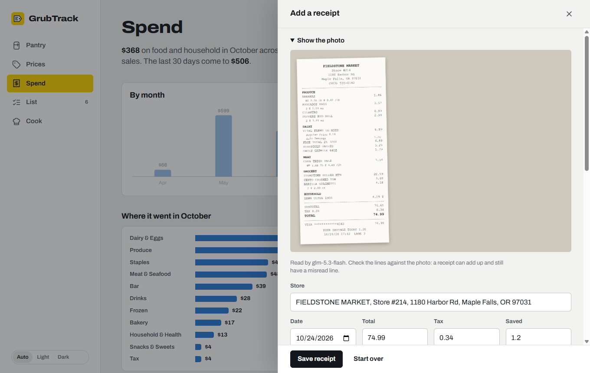
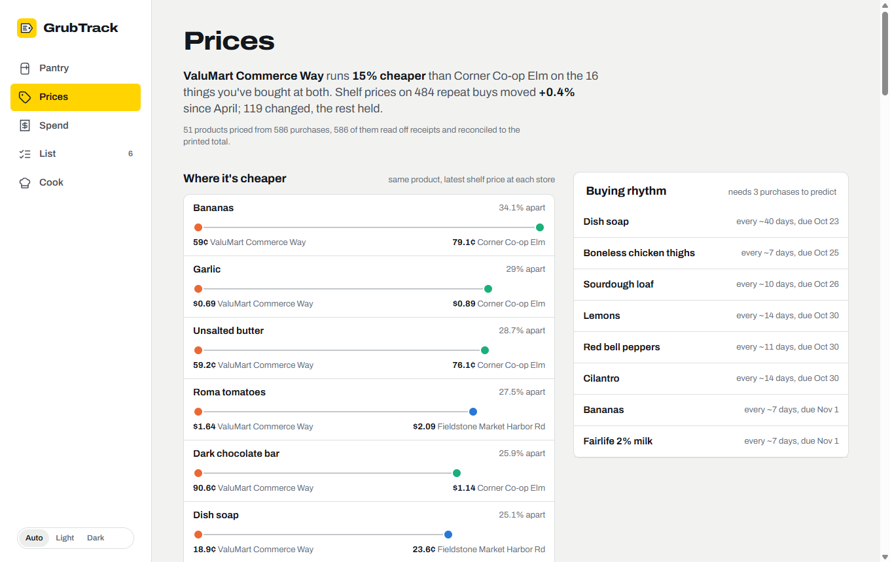
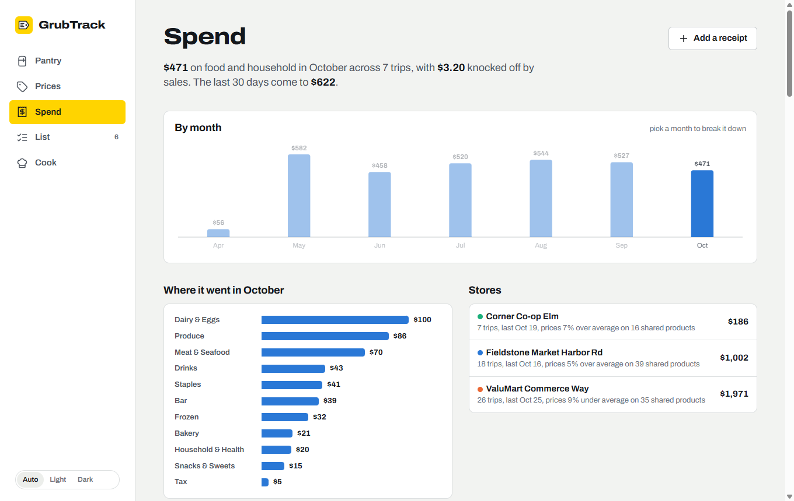
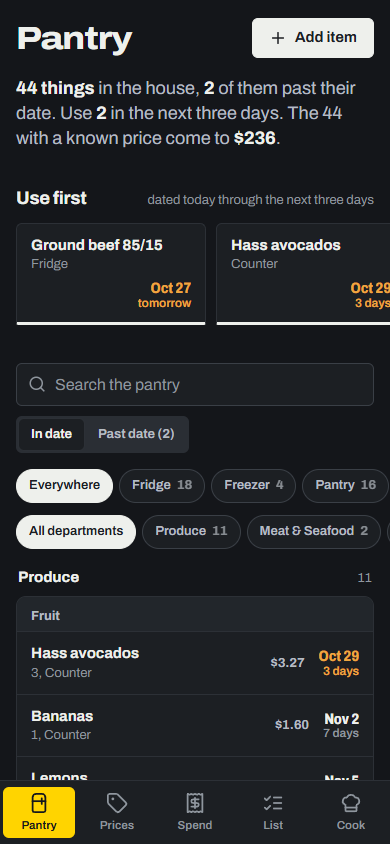
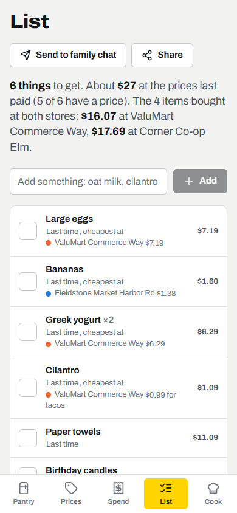

# GrubTrack

A self-hosted pantry, price book and grocery budget for one household. Log what you buy from a
receipt photo, by hand, or by telling your AI agent; GrubTrack keeps every price ever paid and turns
it into answers: what's in the house and when it expires, what eggs cost at each store, what went up,
and where the money went.



## What's in it

| Page | What it shows |
|---|---|
| Pantry | Everything in the house by storage and department, what to use first, what's past its date (nothing leaves until you say it was eaten or tossed) |
| Prices | Where each thing is cheaper, real shelf-price changes (a sale isn't a price change), your personal inflation rate, buying rhythms, and the full price book with a history chart per product |
| Spend | Money out by month, department and store; every trip as a receipt you can check line by line; what got thrown away |
| List | One shopping list with a price estimate per line, the cheaper store, and restock ideas from your buying rhythm |
| Cook | Meal ideas from what's on hand (leading with what expires first), your recipes and an imported recipe library, ranked by how much of each is already in the house |

Every receipt is checked against its printed total: lines plus tax must come to the total, to the
cent, or GrubTrack tells you which way it's off. Products get a department and one of 91 categories
automatically, and package sizes become unit prices so a 32 oz tub and a 5.3 oz cup compare fairly.

| | |
|---|---|
|  |  |
|  |  |

<p>


</p>

## Run it

Docker:

```bash
git clone https://github.com/chungus-actual/grubtrack && cd grubtrack
docker compose up -d            # http://localhost:8888, data in ./data
docker compose exec grubtrack python3 /app/tools/seed_demo.py   # optional: six months of made-up data to explore
```

From source (Python 3.12, Node 22):

```bash
cd frontend && npm ci && npm run build && cd ..
python3 -m venv .venv && .venv/bin/pip install -r backend/requirements.txt
cd backend && ../.venv/bin/uvicorn main:app --port 8888
```

GrubTrack has no login. Keep it on your home network, or put it behind your reverse proxy's
authentication.

## Recipes

Two kinds, both ranked by how much of each recipe is already in the house:

| | Where they live | How they get there |
|---|---|---|
| Your recipes | markdown files in `GT_RECIPES_DIR` (an Obsidian folder works) | Save a recipe on the Cook page: a link (read from the recipe data the page publishes), pasted text (read by the model), or typed in |
| The library | the database, searchable by time, protein, cuisine and dish | Import recipes on the Cook page, or `recipes-import` on the CLI |

The library importer reads Meal-Master and MasterCook text files, Paprika (`.paprikarecipes`) and Mealie
exports, schema.org recipe JSON or saved recipe pages, GrubTrack's own JSON Lines
(`{"title", "ingredients": [...], "instructions"}`), and zips or folders of any of them. Each recipe gets
its protein, cuisine, dish type and time from its ingredients and categories, and a recipe already in
the library (same title, same ingredients) is skipped, so importing the same file twice is safe.
GrubTrack ships no recipe collection of its own.

## AI: a model, an agent, or both

GrubTrack works without any AI: you can type receipts in, and recipe links from most sites import
directly from the recipe data the page publishes. AI adds three things, through two optional slots.

| Job | Who does it |
|---|---|
| Read a receipt photo into lines you check before saving | the model (needs vision) |
| Read pasted recipe text, estimate recipe times | the model, else the agent |
| Suggest meals from what's in the house | the agent, else the model |
| Send the shopping list to a chat | the agent |

**The model** is a direct LLM endpoint: any OpenAI-compatible server (Ollama, LM Studio, vLLM,
OpenRouter, OpenAI) or Claude.

| Example | Settings |
|---|---|
| Ollama on this machine | `GT_MODEL_PROVIDER=openai` `GT_MODEL_URL=http://localhost:11434/v1` `GT_MODEL=gemma4:31b` |
| Ollama cloud | `GT_MODEL_PROVIDER=openai` `GT_MODEL_URL=https://ollama.com/v1` `GT_MODEL=glm-5.3-flash` `GT_MODEL_KEY=...` `GT_MODEL_EFFORT=low` |
| OpenAI | `GT_MODEL_PROVIDER=openai` `GT_MODEL=gpt-5.5` `GT_MODEL_KEY=sk-...` |
| Claude | `GT_MODEL_PROVIDER=anthropic` `GT_MODEL_KEY=sk-ant-...` (model defaults to `claude-opus-5-5`) |

Receipt reading is only as good as the photo and the model, so the draft always comes back for you to
check, with the photo beside it. Measured on real receipts with glm-5.3-flash at `low` effort: a sharp
37-line receipt read perfectly in 17 seconds, a 51-line one with two misread digits (flagged, because it
was 21 cents off the total). With full reasoning on, the same model once "fixed" a misread by changing
the printed tax so the sum worked, which is why lower effort is the safer setting for reading.

**The agent** is an [OpenClaw](https://github.com/openclaw/openclaw) or
[Hermes](https://github.com/NousResearch/hermes-agent) install with GrubTrack's skill (below). It
answers in its own voice with its own memory, and it can act, like sending the list to your family chat.

| Setting | OpenClaw | Hermes |
|---|---|---|
| `GT_AGENT` | `openclaw` | `hermes` |
| How it's called | `openclaw agent --agent main -m <prompt>` | `hermes -z <prompt>` |
| `GT_AGENT_NAME` | what the app calls it ("Ask *Juniper* for dinner") | same |
| `GT_LIST_SEND_TO` | where the List page's Send button sends to, in words the agent understands: `Telegram chat 123456789` | same |

The agent slot runs the harness's CLI, so GrubTrack has to run where that CLI does (from source on the
same machine, or an image you extend).

## The agent skill

`skill/food-inventory/` is a skill for OpenClaw and Hermes (the [AgentSkills](https://agentskills.io)
format both read). With it, your agent logs groceries from photos and messages, records receipts line by
line (and won't call one done until it adds up), and answers questions like "what's expiring
tomorrow", "where are eggs cheaper" and "what did we spend this month" from the same database GrubTrack
shows.

```bash
python3 tools/install_skill.py openclaw --db ~/grubtrack/data/food.db
python3 tools/install_skill.py hermes   --db ~/grubtrack/data/food.db --local our-house.md
```

The installer copies the skill into the harness's skills folder, writes in its absolute path, and pins
the database so the agent and the web app open the same `food.db`. `--local` adds household notes as
`LOCAL.md`, which the skill reads first: who's who, which chat to confirm in, house rules. Re-running it
updates the skill and keeps the pin and the notes; the previous copy is archived.

### When GrubTrack runs somewhere else

GrubTrack in a container on a NAS and the agent on your desktop is the usual setup, and SQLite can't be
shared over a network. So the skill's CLI can send every command to GrubTrack instead: same commands,
same output, and the files a command names (a receipt JSON, a recipe collection, the photo a payload
points at) are uploaded with it.

```bash
python3 tools/install_skill.py openclaw --url https://nas.lan:8888 --token "$GT_API_TOKEN" --ca house-ca.pem
```

GrubTrack runs the command against its own database (`POST /api/cli`) and returns what the CLI would
have printed. Scripts that read the database with their own SQL can use a fresh read-only copy:
`fooddb_sqlite.py snapshot` prints its path (`GET /api/export/db`; `--scope core` leaves out the recipe
library). Set `GT_API_TOKEN` on the server so only the agent can do this.

## The CLI

The skill's script is a complete command line for the same data (`grubtrack` inside the Docker image):

```bash
S=skill/food-inventory/scripts/fooddb_sqlite.py
python3 $S where                                  # which food.db it uses
python3 $S add --name "Greek yogurt" --storage fridge --exp 2026-11-02 --price 6.49
python3 $S expiring --days 3
python3 $S receipt-add --file receipt.json        # checked against the printed total
python3 $S prices --q eggs                        # last price, per store, shelf change, store gap
python3 $S spend --days 30
python3 $S shop-add --name "oat milk"
python3 $S recipes-import --file ~/Downloads/recipes.zip   # add --dry-run to see what's in it first
python3 $S journal-add --slug pad-thai --score 8 --review "Better with more lime"
python3 $S snapshot                                # a read-only copy for your own SQL
```

`python3 $S --help` lists everything. The receipt JSON format is in the skill's `SKILL.md`.

## Settings

| Variable | Default | What it does |
|---|---|---|
| `GT_DATA` | `~/.local/share/grubtrack` (`/data` in Docker) | folder for `food.db`, photos and recipes |
| `FOODDB_PATH` | `$GT_DATA/food.db` | the database itself, if it lives elsewhere |
| `GT_RECIPES_DIR` | `$GT_DATA/recipes` | your recipes: markdown files with an `## Ingredients` list (an Obsidian folder works) |
| `GT_RECIPES_WRITE` | `1` | `0` stops the app saving new recipes there |
| `GT_MEDIA_ROOT` | `$GT_DATA` | folder relative photo paths resolve against (an agent's workspace, if it records paths from there) |
| `GT_MODEL_PROVIDER` | none | `openai` (any compatible server) or `anthropic` |
| `GT_MODEL` | none (`claude-opus-5-5` for anthropic) | model id |
| `GT_MODEL_URL` | `https://api.openai.com/v1` | base URL, the part before `/chat/completions` |
| `GT_MODEL_KEY` | none | API key (Claude also reads `ANTHROPIC_API_KEY`) |
| `GT_MODEL_EFFORT` | none | `low`, `medium` or `high`, for models that take it |
| `GT_MODEL_VISION` | `1` | `0` if the model can't read images |
| `GT_MODEL_MAX_TOKENS`, `GT_MODEL_TIMEOUT` | provider default, `180` | output cap, seconds |
| `GT_AGENT` | none | `openclaw` or `hermes` |
| `GT_AGENT_NAME` | `OpenClaw` / `Hermes` | the name shown in the app |
| `GT_AGENT_CMD` | `openclaw` / `hermes` | the command, if it isn't on `PATH` (e.g. `/usr/bin/node /opt/openclaw/openclaw.mjs`) |
| `GT_OPENCLAW_AGENT` | `main` | which OpenClaw agent answers |
| `GT_AGENT_PATH`, `GT_AGENT_TIMEOUT` | server's `PATH`, `300` | `PATH` for the agent process, seconds |
| `GT_LIST_SEND_TO`, `GT_LIST_SEND_LABEL` | none, `chat` | where Send delivers the list, and the button's label |
| `GT_AI_STYLE` | plain markdown, no em dashes | style line added to every prompt |
| `GT_MEAL_NOTES` | none | household preferences added to meal-idea prompts |
| `GT_SWEEP_SECONDS` | `30` | how often rows written by other tools get categorized and priced |
| `GT_API_TOKEN` | none | bearer token required by `/api/cli` and `/api/export/db` (the agent's CLI sends it) |
| `GT_BACKUPS` | `14` | nightly copies of `food.db` kept in `$GT_DATA/backups` (`0` turns them off) |
| `GT_TLS_CERT`, `GT_TLS_KEY` | none | serve HTTPS with this certificate and key |
| `GT_PORT` | `8888` | port |
| `TZ` | server's | "today" for expiry dates is the server's date |

## How the data works

| Rule | Why |
|---|---|
| Every price lands in a `purchases` ledger, never only on the pantry row | a restock merges into the existing row, which would overwrite the old price |
| A receipt is complete when lines plus tax equal the printed total (±$0.02) | the total is the one number you can check a transcription against |
| Receipt lines that didn't stock the pantry (bags, cleaning, extras) are ledger lines, not pantry rows | the spend and price history are real either way |
| A price change is the shelf price at one store between two visits | a sale is a deal, and a different store is a store gap; neither is inflation |
| Sold-by-weight packages are compared only when the weight is known | two packs of deli turkey say nothing per pound |
| A buying rhythm predicts a due date only after three purchases | two purchases are a gap, not a rhythm |
| Deleting a pantry item is soft and records eaten or tossed | that's what the restock ideas and the waste numbers learn from |

## Development

| Path | What |
|---|---|
| `skill/food-inventory/` | the agent skill: `SKILL.md`, the CLI (`scripts/fooddb_sqlite.py`) and `scripts/foodcore/` (schema, taxonomy, unit prices, receipt ledger, price analytics, recipe import) |
| `backend/app/` | FastAPI; `ai/` holds the model and agent providers |
| `frontend/src/` | React 18 + Vite: `pages/` and `sheets/` (detail panels addressed by URL, `?open=product:<id>`) |
| `tools/` | `install_skill.py`, `seed_demo.py` |
| `tests/` | pytest: the core, the CLI, the API, the AI layer (mock transports and fake agent CLIs, no network) |

```bash
pip install -r backend/requirements-dev.txt && python -m pytest -q tests
cd frontend && npm run dev        # proxies /api to :8888
```

## License

MIT
